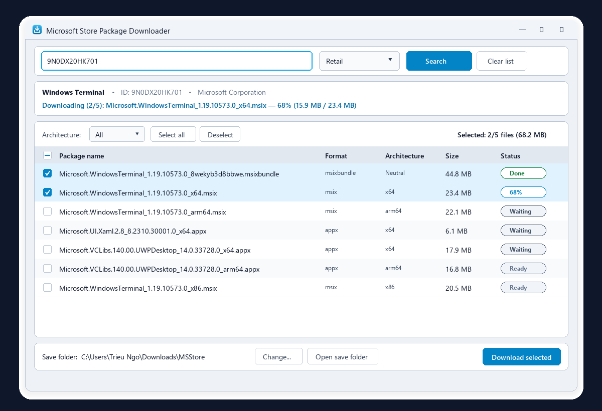
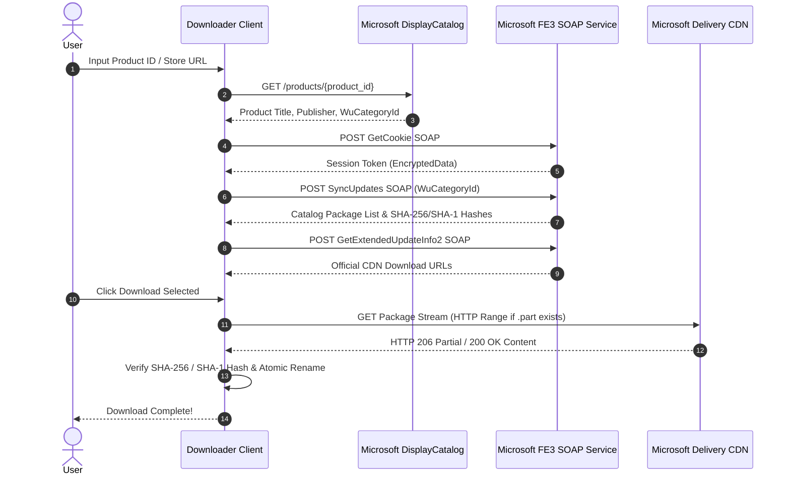

<div align="center">


# Microsoft Store Package Downloader

**Lightweight, fast, and modern Windows desktop application (~10MB) for directly downloading official Microsoft Store packages (`.msix`, `.appx`, `.msixbundle`, `.appxbundle`) via official Microsoft FE3 SOAP APIs without third-party intermediaries.**

[](https://www.python.org/)
[](https://www.microsoft.com/windows)
[](https://docs.python.org/3/library/tkinter.html)
[](LICENSE)
[](#architecture)

<br/>



</div>

---

## Key Features

- **Direct Microsoft FE3 SOAP Connection:** Connects straight to Microsoft's official Windows Update / Delivery Optimization servers (`fe3.delivery.mp.microsoft.com`). No dependency on RG-AdGuard, web scrapers, or third-party proxies.
- **HTTP Range Resume Download (`Range: bytes={have}-`):** Interrupted or cancelled downloads automatically preserve partial files (`.part`). Resuming downloads starts seamlessly from the exact byte you left off instead of redownloading from scratch.
- **Dual SHA-256 & SHA-1 Integrity Verification:** Extracts both modern SHA-256 (`<AdditionalDigest>`) and legacy SHA-1 (`<Digest>`) cryptographic hashes. Automatically verifies downloads against corrupted files or network drops.
- **One-Click Package Extraction ("Extract package files"):** Right-click any completed `.msix`, `.appx`, `.msixbundle`, or `.appxbundle` package to unpack its manifest and assets into a dedicated folder with real-time percentage progress and automatic File Explorer navigation.
- **Architecture & Ring Filtering:** Easily filter packages by CPU architecture (`x64`, `x86`, `ARM64`, `ARM`, `Neutral`) and select your desired release channel (`Retail`, `Release Preview`, `Insider Slow`, `Insider Fast`).
- **Batch Selection & Live Summary:** Multi-select packages with crisp checkbox controls, dynamic total download size calculation, and waiting/downloading/done queue states.
- **Ultra-Lightweight & Clean Native UI:** Pure Python standard library with Tkinter, calibrated WCAG AAA contrast, zero flickers, High-DPI Windows display scaling, and a standalone executable size under 11MB.

---

## Quick Start

### 1. Run from Source

Make sure you have [Python 3.10+](https://www.python.org/) installed:

```bash
# Clone the repository
git clone https://github.com/ngo-trieu/msstore-package-downloader.git
cd msstore-package-downloader

# Install minimal network dependencies (requests, urllib3)
pip install -r requirements.txt

# Launch the app
python app.py
```

Or simply double-click **`run.bat`** on Windows!

### 2. Build Standalone Portable EXE

To compile the entire app into a single standalone `.exe` without needing Python installed on the target machine:

```bash
build_exe.bat
```

The resulting binary will be saved in `dist/MSStoreDownloader.exe` (~10MB, powered by Nuitka).

---

## How to Use

1. **Search:** Enter any Microsoft Store URL (e.g. `https://apps.microsoft.com/detail/9N0DX20HK701`) or a 12-character Product ID (e.g. `9N0DX20HK701` for Windows Terminal) and click **Search**.
2. **Select:** Filter packages by architecture if desired, then check the packages you want to download.
3. **Download:** Click **Download selected**. You can track download progress, percentage, and speed directly in the interface.
4. **Context Menu:** Right-click any row to:
   - **Download this package** / **Cancel active download**
   - **Copy download link** or **Copy package name**
   - **Open file location** (highlights the file in Windows Explorer)
   - **Extract package files** (unpacks `.msix`/`.appx` files into a subfolder)

---

## Architecture

The downloader communicates directly with Microsoft's official Client Web Service:



---

## Project Structure

```text
├── assets/
│   ├── app.ico             # Windows multi-resolution taskbar icon (256x256 to 16x16)
│   ├── app.png             # Crisp high-res 256x256 logo
│   └── preview.png         # Modern application screenshot preview
├── app.py                  # High-contrast Native Tkinter GUI & thread-safe queues
├── ms_store_api.py         # Direct Microsoft FE3 SOAP client & package extractor
├── soap_templates.py       # MS-WUSP dynamic SOAP envelope builders
├── i18n.py                 # English string resources & persistent configuration
├── make_icon.py            # High-resolution vector icon generator
├── make_preview.py         # README screenshot generator
├── _test.py                # 13 comprehensive automated test suites (100% pass)
├── run.bat                 # Convenient 1-click launcher
├── build_exe.bat           # Standalone single-file EXE compiler (Nuitka)
├── push_to_github.bat      # 1-click GitHub push script
└── requirements.txt        # Minimal dependencies (requests, urllib3)
```

---

## Disclaimer

This project is an independent open-source tool and is not affiliated with, endorsed by, or sponsored by Microsoft Corporation. *Microsoft*, *Windows*, *Microsoft Store*, and *Windows Update* are registered trademarks of Microsoft Corporation. All packages are retrieved directly from official Microsoft Content Delivery Network servers without any cracking, modification, or DRM circumvention.

---

## License

This project is licensed under the [MIT License](LICENSE).
